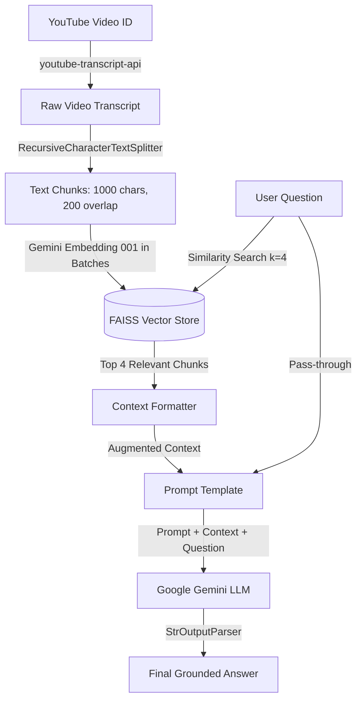

# 🎬 YouTube Video RAG (Retrieval-Augmented Generation)

An end-to-end **Retrieval-Augmented Generation (RAG)** chatbot and question-answering pipeline that allows users to chat directly with any YouTube video. 

By extracting video transcripts, chunking them into semantic fragments, generating high-dimensional vector embeddings with **Google Gemini**, and indexing them in a **FAISS** vector database, this system retrieves precise video context to produce accurate, hallucination-free answers using **LangChain Expression Language (LCEL)**.

---

## 📌 Architecture Overview



---

## ✨ Key Features

- **Direct Transcript Ingestion**: Fetches accurate spoken subtitles directly via the YouTube Transcript API without needing to download heavy video or audio files.
- **Smart Semantic Chunking**: Employs `RecursiveCharacterTextSplitter` (chunk size: `1000`, overlap: `200`) to preserve sentence integrity and retain conversational context across boundaries.
- **Gemini Embeddings with Batch Ingestion**: Utilizes Google's `gemini-embedding-001` with automated batching and delay mechanisms to stay within API rate limits during vector creation.
- **High-Performance In-Memory Retrieval**: Leverages **FAISS** (Facebook AI Similarity Search) for fast semantic similarity search and top-$k$ document retrieval.
- **Hallucination Prevention**: Enforces strict prompt boundaries instructing the LLM to answer *only* from the provided transcript context, acknowledging unknowns when context is insufficient.
- **Declarative LCEL Pipeline**: Implements the entire query-retrieval-augmentation-generation workflow using modern **LangChain Expression Language (LCEL)** (`RunnableParallel`, `RunnablePassthrough`, `RunnableLambda`, `StrOutputParser`).

---

## 🛠️ Tech Stack

| Component | Technology | Description |
| :--- | :--- | :--- |
| **Orchestration** | [LangChain](https://www.langchain.com/) / LCEL | Composable, declarative chain pipeline |
| **Embeddings** | [Google Generative AI](https://ai.google.dev/) (`gemini-embedding-001`) | High-dimensional semantic text embeddings |
| **LLM** | [Google Gemini](https://ai.google.dev/) (`gemini-3.6-flash` / Gemini series) | Context-aware generative response synthesis |
| **Vector Database** | [FAISS CPU](https://github.com/facebookresearch/faiss) | Dense vector similarity index |
| **Data Source** | [YouTube Transcript API](https://github.com/jdepoix/youtube-transcript-api) | Captions & subtitle extractor |
| **Configuration** | `python-dotenv` | Environment and API key management |

---

## 📂 Project Structure

```text
Youtube-RAG/
├── .env.example            # Sample environment variables file
├── .gitignore              # Git ignore rules for Python, caches, and secrets
├── README.md               # Comprehensive project documentation
├── requirements.txt        # Python package dependencies
├── Youtube_RAG_V1.ipynb    # Main Jupyter Notebook containing the full RAG pipeline
└── .vscode/
    └── settings.json       # VS Code workspace settings
```

---

## 🚀 Getting Started

### 1. Prerequisites

- Python 3.9+ installed on your machine
- A Google AI Studio API Key (Obtain free at [Google AI Studio](https://aistudio.google.com/))

### 2. Clone the Repository

```bash
git clone https://github.com/Maanit5117/Youtube-RAG.git
cd Youtube-RAG
```

### 3. Create a Virtual Environment

```bash
# On macOS / Linux:
python3 -m venv venv
source venv/bin/activate

# On Windows:
python -m venv venv
venv\Scripts\activate
```

### 4. Install Dependencies

```bash
pip install -r requirements.txt
```

### 5. Configure Environment Variables

Create a `.env` file in the root directory by copying the example:

```bash
cp .env.example .env
```

Open `.env` and insert your Gemini API Key:

```env
GEMINI_API_KEY="your-gemini-api-key-here"
```

---

## 📖 Pipeline Walkthrough

The notebook [`Youtube_RAG_V1.ipynb`](file:///Users/maanitmittra/Documents/youtube%20chatbot%20RAG/Youtube_RAG_V1.ipynb) breaks down the system into clear, sequential stages:

### Step 1: Ingestion & Indexing
1. **Fetch Transcript**: `YouTubeTranscriptApi` fetches English captions for the specified `video_id`.
2. **Text Splitting**: `RecursiveCharacterTextSplitter` cuts the transcript into manageable chunks (1000 characters with 200 character overlap).
3. **Embeddings & Vector Store**: Chunks are processed in batches through `GoogleGenerativeAIEmbeddings(model="gemini-embedding-001")` and stored in a `FAISS` index.

### Step 2: Retrieval
The FAISS vector store is converted into a similarity retriever:
```python
retriever = vector_store.as_retriever(search_type="similarity", search_kwargs={"k": 4})
```

### Step 3: Augmentation (Prompt Engineering)
A strict system prompt is defined to ground all answers strictly in the transcript text:
```python
prompt = PromptTemplate(
    template="""
      You are a helpful assistant.
      Answer ONLY from the provided transcript context.
      If the context is insufficient, just say you don't know.

      {context}
      Question: {question}
    """,
    input_variables=['context', 'question']
)
```

### Step 4: Generation via LCEL
The pipeline is composed into a unified chain using LangChain Expression Language:
```python
parallel_chain = RunnableParallel({
    'context': retriever | RunnableLambda(format_docs),
    'question': RunnablePassthrough()
})

main_chain = parallel_chain | prompt | llm | parser

# Invoke the complete chain
response = main_chain.invoke("Can you summarize the video?")
print(response)
```

---

## ⚙️ Key Configurable Parameters

| Parameter | Location | Default | Purpose |
| :--- | :--- | :--- | :--- |
| `video_id` | Notebook Cell 5 | `"TjPPIf-M6KE"` | Target YouTube video ID |
| `chunk_size` | Splitter | `1000` | Max character length per chunk |
| `chunk_overlap` | Splitter | `200` | Overlap between consecutive chunks |
| `batch_size` | Embedding loop | `20` | Number of chunks embedded per batch |
| `k` | Retriever | `4` | Number of relevant chunks retrieved |
| `temperature` | LLM | `0.2` | Controls randomness (lower = more deterministic) |
| `max_output_tokens` | LLM | `4096` | Maximum response length |

---

## 🛡️ Error Handling & Edge Cases

- **`TranscriptsDisabled`**: If the YouTube video does not have available captions or transcripts, the script gracefully catches the error and alerts the user.
- **API Rate Limits**: The embedding generator includes batch pauses (`time.sleep(15)`) to avoid hitting free-tier Google AI Studio API rate limits on large transcripts.
- **Out-of-Context Questions**: The strict prompt design ensures that questions not covered in the video receive an honest fallback answer rather than fabricated hallucinations.

---

## 🔮 Future Improvements

- [ ] Support for YouTube playlists and multi-video querying
- [ ] Interactive UI with Streamlit or Gradio
- [ ] Timestamps in answers linking directly to the exact moment in the video
- [ ] Support for non-English / multilingual transcripts with auto-translation
- [ ] Persistent vector store on disk or managed cloud vector DB (e.g., Pinecone, ChromaDB, Qdrant)

---

## 👤 Author

- **Maanit Mittra** - [GitHub Profile](https://github.com/Maanit5117)
- Repository: [Maanit5117/Youtube-RAG](https://github.com/Maanit5117/Youtube-RAG)

---

## 📄 License

This project is licensed under the [MIT License](LICENSE).
